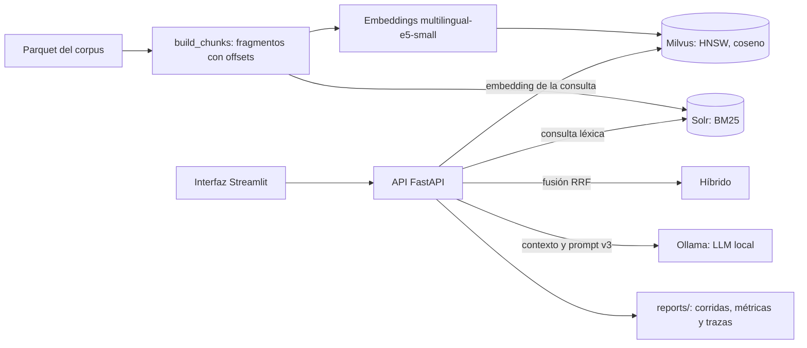

# Taller RAG: Solr, Milvus y generación local

**Informe del taller (PDF): [informe_taller_rag.pdf](informe_taller_rag.pdf)** · Grupo 4, Procesamiento de Lenguaje Natural, Pontificia Universidad Javeriana.

Sistema de preguntas con evidencia sobre `dragons_rag`, corpus del catálogo
`open_corpus_co_es==0.1.1a4`. Compara recuperación léxica (Solr, BM25), densa
(Milvus) e híbrida (RRF), y genera las respuestas con modelos locales de Ollama.
La API es FastAPI y la interfaz de comparación es Streamlit. La arquitectura y
las decisiones están en [informe_taller_rag.pdf](informe_taller_rag.pdf), en las
secciones de arquitectura y decisiones. Las [evidencias de funcionamiento](reports/demo/)
incluyen las capturas de la demostración.

## Arquitectura



El detalle de cada componente y las decisiones están en el informe.

## Requisitos

- Windows 11 con Docker Desktop y WSL2, o Linux con Docker Engine y Compose v2.
- 16 GB de RAM recomendados (a la VM de Docker, al menos 8 GB y 4 CPU) y unos 25 GB de disco.
- Python 3.11 o posterior en el host.
- GPU NVIDIA opcional. Sin ella, quitar el bloque `deploy` de `ollama` en una copia del compose.

## Puesta en marcha

Ejecutar todo desde la raíz del repositorio.

**1. Entorno de Python.**

```text
python -m venv .venv
python -m pip install torch==2.6.0+cpu --index-url https://download.pytorch.org/whl/cpu
python -m pip install -r requirements.txt
```

Activar antes el entorno: `.\.venv\Scripts\Activate.ps1` en PowerShell o
`source .venv/bin/activate` en Bash.

**2. Corpus.** Descargar y copiar el Parquet a `data/`:

```text
python -m pip install open_corpus_co_es==0.1.1a4
python -m open_corpus_co_es --download dragons_rag
python -c "from pathlib import Path; from shutil import copyfile; from open_corpus_co_es.downloader import get_corpus_path; Path('data').mkdir(exist_ok=True); copyfile(Path(get_corpus_path('dragons_rag')) / 'dragons_rag.parquet', 'data/documentos_rag.parquet')"
```

Verificar la copia (`Get-FileHash data/documentos_rag.parquet -Algorithm SHA256`
en PowerShell, `sha256sum data/documentos_rag.parquet` en Linux). Debe dar
`f4a669f17eaedd357f72b70c2192e685b6d534a94f6ffaeadbced7290b181728`. Si difiere,
detenerse y obtener el archivo correcto.

**3. Configuración.** `Copy-Item .env.example .env` (PowerShell) o
`cp .env.example .env` (Bash). Dejar los valores por defecto.

**4. Servicios.** Esperar a que los siete queden `healthy`:

```text
docker compose up -d --build
docker compose ps
```

**5. Tokenizer y encoders.** El tokenizer debe estar en la caché del host
(`build_chunks` usa `local_files_only=True`):

```text
python -c "from transformers import AutoTokenizer; AutoTokenizer.from_pretrained('intfloat/multilingual-e5-small')"
docker compose exec api python -c "from app.embeddings import dim; print(dim('e5small')); print(dim('minilm'))"
```

**6. Modelos de Ollama.** Cuatro generadores y un juez (`qwen2.5:7b`):

```text
docker compose exec ollama ollama pull qwen2.5:1.5b
docker compose exec ollama ollama pull llama3.2:1b
docker compose exec ollama ollama pull gemma2:2b
docker compose exec ollama ollama pull llama3.2:3b
docker compose exec ollama ollama pull qwen2.5:7b
```

**7. Muestras.**

```text
python -m scripts.profile_corpus --input data/documentos_rag.parquet --out reports/perfilado
python -m scripts.make_sample --input data/documentos_rag.parquet --n 700 --seed 42 --out data/samples/sample_700.csv
python -m scripts.make_sample --input data/documentos_rag.parquet --n 10000 --seed 42 --out data/samples/sample_10k.csv
```

**8. Chunks.**

```text
python -m scripts.build_chunks --input data/documentos_rag.parquet --sample data/samples/sample_700.csv --extra data/synthetic/injection_docs.jsonl --chunker tok256 --out data/derived/chunks_tok256.jsonl
python -m scripts.build_chunks --input data/documentos_rag.parquet --sample data/samples/sample_700.csv --extra data/synthetic/injection_docs.jsonl --chunker sent256 --out data/derived/chunks_sent256.jsonl
python -m scripts.build_chunks --input data/documentos_rag.parquet --sample data/samples/sample_700.csv --extra data/synthetic/injection_docs.jsonl --chunker tok128 --out data/derived/chunks_tok128.jsonl
python -m scripts.build_chunks --input data/documentos_rag.parquet --sample data/samples/sample_10k.csv --extra data/synthetic/injection_docs.jsonl --chunker tok256 --label-suffix _10k --out data/derived/chunks_tok256_10k.jsonl
```

**9. Indexación.** `--resume` omite los lotes ya presentes. Si cambia la
entrada, usar `--recreate`, que borra la colección o el chunker.

```text
docker compose exec api python -m scripts.index_milvus --chunks data/derived/chunks_tok256.jsonl --encoder e5small --resume --describe
docker compose exec api python -m scripts.index_solr --chunks data/derived/chunks_tok256.jsonl --resume
docker compose exec api python -m scripts.index_milvus --chunks data/derived/chunks_sent256.jsonl --encoder e5small --resume --describe
docker compose exec api python -m scripts.index_solr --chunks data/derived/chunks_sent256.jsonl --resume
docker compose exec api python -m scripts.index_milvus --chunks data/derived/chunks_tok128.jsonl --encoder e5small --resume --describe
docker compose exec api python -m scripts.index_solr --chunks data/derived/chunks_tok128.jsonl --resume
docker compose exec api python -m scripts.index_milvus --chunks data/derived/chunks_tok256.jsonl --encoder minilm --resume --describe
docker compose exec api python -m scripts.index_milvus --chunks data/derived/chunks_tok128.jsonl --encoder minilm --describe
docker compose exec api python -m scripts.index_milvus --chunks data/derived/chunks_tok256_10k.jsonl --encoder e5small --resume --describe
docker compose exec api python -m scripts.index_solr --chunks data/derived/chunks_tok256_10k.jsonl --resume
```

El índice MiniLM con `tok128` crea la colección `c_minilm_tok128`.

**Vía rápida.** Con dependencias, cachés y corpus listos, los pasos 3 a 9 se
resumen en `powershell -NoProfile -File scripts/init.ps1` o `bash scripts/init.sh`.
Crean `.env` si falta, verifican el SHA-256, levantan Compose, descargan modelos y
crean muestra, chunks e índices piloto. Se pueden repetir sin efectos. Las
variables `PYTHON`, `MODELOS` y `ESPERA_MAX` ajustan el ejecutable, la lista de
modelos y el plazo en segundos.

## Uso

- API: <http://localhost:8000/docs>. `GET /health` puede responder 200 con
  estado `degraded`, así que conviene mirar el cuerpo.
- UI: <http://localhost:8501>. Compara citas, evidencias y tiempos entre motores.
- `POST /ask` acepta `backend=milvus|solr|hybrid`, `one_per_doc` y filtros por
  `collection_name` o `language`. Ejemplo de cuerpo:

```json
{"query":"¿Qué dicen los documentos sobre la transición energética?","backend":"solr","model":"gemma2:2b","k":5,"chunker":"tok256","encoder":"e5small","prompt_version":"rag_v3","temperature":0}
```

## Reproducir la evaluación

Con los índices completos y sin otras corridas activas. Entre la validación y
`score_generation` hay dos pausas manuales: anotar la relevancia en copias A/B
(`relevancia_A.csv` y `relevancia_B.csv` en `eval/annotations/`) y completar las
hojas de `eval/human/` con la [rúbrica](eval/rubrica.md). El protocolo está en
[docs/EVALUACION.md](docs/EVALUACION.md).

En esta entrega calificamos 8 de las 30 respuestas de las hojas (una por combinación
de modelo y buscador); `human_eval agree` ignora las filas sin calificar y deja el
resumen en `reports/generation/human_eval.csv`. La doble anotación de relevancia
de 12 preguntas está en `eval/annotations/relevancia_A.csv` y `relevancia_B.csv` (kappa 0,95).

```text
docker compose exec api python -m scripts.validate_gold --gold eval/gold.jsonl --sample data/samples/sample_700.csv --synthetic data/synthetic/injection_docs.jsonl
docker compose exec api python -m scripts.pool_candidates --gold eval/gold.jsonl --k 3 --chunker tok256 --out-dir eval/annotations
docker compose exec api python -m scripts.pool_candidates --gold eval/gold.jsonl --k 3 --chunker tok256 --qids Q14,Q15,Q22,Q26,Q27,Q30,Q32,Q34,Q39,Q41,Q46,Q48 --blind --out-dir eval/annotations
docker compose exec api python -m scripts.validate_gold --agreement eval/annotations/relevancia_A.csv eval/annotations/relevancia_B.csv
docker compose exec api python -m scripts.eval_retrieval --gold eval/gold.jsonl --split all --conditions main,ablations,filters,10k --out reports/retrieval
docker compose exec api python -m scripts.run_generation --gold eval/gold.jsonl --split test --backends milvus solr --models qwen2.5:1.5b llama3.2:1b gemma2:2b llama3.2:3b --runs 3 --k 5 --chunker tok256 --encoder e5small --prompt rag_v3 --temperature 0 --tag main
docker compose exec api python -m scripts.run_generation --split test --backends milvus --models gemma2:2b --runs 3 --k 3 --tag abl_k3
docker compose exec api python -m scripts.run_generation --split test --backends milvus --models gemma2:2b --runs 3 --k 10 --tag abl_k10
docker compose exec api python -m scripts.run_generation --split test --backends milvus --models gemma2:2b --runs 3 --chunker tok128 --tag abl_tok128
docker compose exec api python -m scripts.run_generation --split test --backends milvus --models gemma2:2b --runs 3 --chunker sent256 --tag abl_sent256
docker compose exec api python -m scripts.run_generation --split test --backends milvus --models gemma2:2b --runs 3 --encoder minilm --tag abl_minilm
docker compose exec api python -m scripts.run_generation --split test --backends milvus --models gemma2:2b --runs 3 --tag abl_minilm_tok128 --chunker tok128 --encoder minilm
docker compose exec api python -m scripts.run_generation --split test --backends milvus --models gemma2:2b --runs 3 --one-per-doc --tag abl_onedoc
docker compose exec api python -m scripts.judge_local --judge qwen2.5:7b --tags main --run-idx 1 --resume
docker compose exec api python -m scripts.score_generation --tags main abl_k3 abl_k10 abl_tok128 abl_sent256 abl_minilm abl_minilm_tok128 abl_onedoc
docker compose exec api python -m scripts.human_eval sample --tags main --n 30 --seed 42 --out eval/human
docker compose exec api python -m scripts.human_eval agree --a eval/human/hoja_evaluador_A.csv --b eval/human/hoja_evaluador_B.csv --key eval/human/clave_items.csv --out reports/generation
docker compose exec api python -m scripts.score_generation --tags main abl_k3 abl_k10 abl_tok128 abl_sent256 abl_minilm abl_minilm_tok128 abl_onedoc
docker compose exec api python -m scripts.embeddings_probe --out reports/embeddings --k 5
python -m scripts.analyze --reports reports --tex informe/tablas
```

No ejecutar el juez y la generación a la vez: compiten por el único modelo cargado.
`analyze` corre en el host porque `informe/` no está montado en la API.

## Pruebas

```text
pytest -q
docker compose exec api pytest -q
docker compose exec api pytest -q -m integration
```

El marcador `integration` necesita índices, modelos y servicios reales; se omite
si Milvus no responde.

## Estructura

```text
app/        API, recuperación, encoders, RAG, métricas y UI
scripts/    perfilado, muestras, chunks, índices, evaluación e inicialización
prompts/    rag_v1, rag_v2 y rag_v3
data/       Parquet local, samples/, synthetic/ y derived/ (privado)
solr/       configset léxico con esquema explícito
eval/       gold, rúbrica y anotaciones
tests/      pruebas unitarias y de integración
docs/       protocolo de evaluación
reports/    agregados, capturas y corridas locales
```

## Problemas frecuentes

| Problema | Solución |
|---|---|
| Disco de Docker lleno | Mover la imagen de disco en Docker Desktop, Settings, Resources, y comprobar el espacio libre. |
| Milvus sale con código 1 | Suele perder la sesión de etcd por pausas de memoria de la VM. Compose lo reinicia hasta 5 veces y los datos siguen en `milvus_data`. Ver `docker compose logs milvus`. |
| Modelo no descargado | La API devuelve 400 con el comando `docker compose exec ollama ollama pull NOMBRE`. |
| Poca memoria u Ollama se cae | Cerrar otras aplicaciones y no subir `k` ni el contexto. Con menos de 6 GB para Ollama aparecen errores OOM. |
| Tokenizer ausente | Repetir el paso 5 en el host. La caché de la API no lo reemplaza. |
| Git Bash cambia `/tmp/...` al llamar a Docker | Usar rutas relativas al repositorio dentro del contenedor. |

`docker compose down` conserva los volúmenes con índices y modelos; `down -v` los borra.

## Qué no se publica

No se suben el Parquet ni los textos completos, porque dependen de la licencia del
corpus. Tampoco `data/derived/` (se regenera con el paso 8), los pesos de modelos
(se bajan con Ollama) ni datos personales: los `@handles` se enmascaran en el
contexto y en las exportaciones, y los JSONL crudos pueden conservar textos y URL
originales, por lo que se revisan antes de compartirse.

## Equipo

Grupo 4, Procesamiento de Lenguaje Natural, Pontificia Universidad Javeriana.

- Massimo Enrique Maimone Guazzo
- Jose Miguel Bejarano Restrepo
- Juan Felipe Guzmán Sandoval
- Silvio Mauricio Morales Osorio
- David Alejandro Castillo Chiquiza
