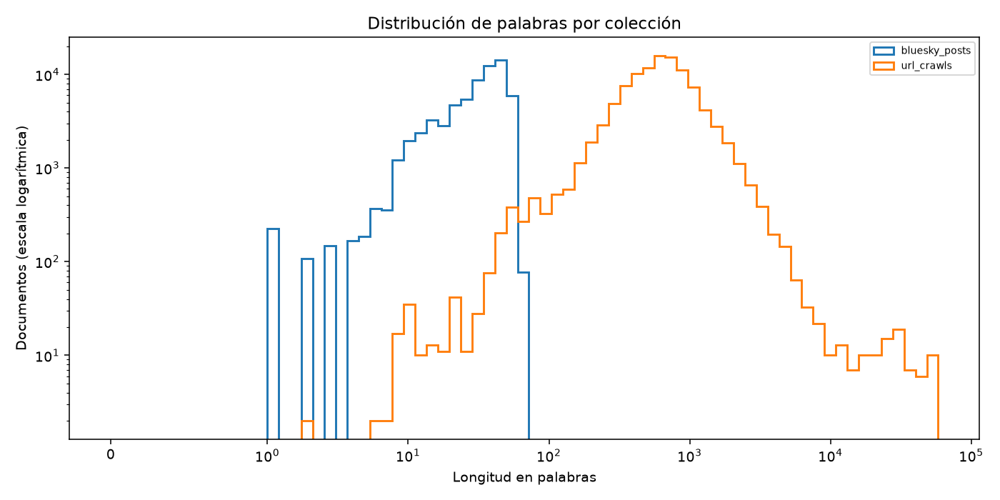
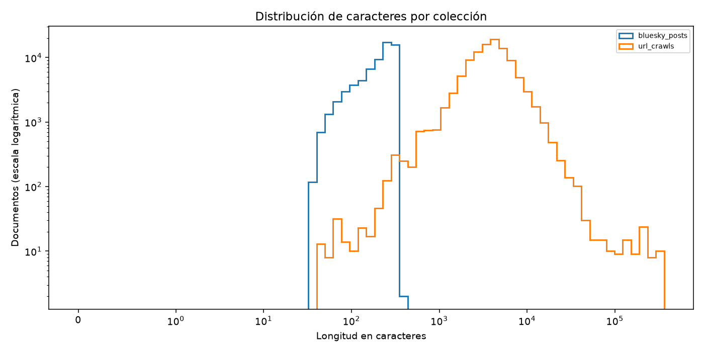

# Perfilado del corpus

Filas: 169248. Duplicados por hash (filas posteriores a la primera): 14771.

## Integridad y esquema

Campos: 33; columnas hoja Parquet: 34. No hay índice pandas.
Los campos anidados explican la diferencia: keyword_matches es una lista de cadenas; top_terms es una lista de estructuras con term y count.
{"keyword_matches": {"type": "list<element: string>", "leaf_paths": ["keyword_matches.list.element"]}, "top_terms": {"type": "list<element: struct<term: string, count: int64>>", "leaf_paths": ["top_terms.list.element.term", "top_terms.list.element.count"]}}
IDs únicos: True; IDs nulos: 0; textos vacíos: 0.
Discrepancias text_sha256: 0; variantes (discrepancias): {"UTF-8 literal": 0}.
Discrepancias word_count: 0; char_count: 0.
Palabras: len(text.split()); caracteres: len(text); nulos tratados como cadena vacía solo al medir.

| Columna | Tipo físico | % nulos |
|---|---|---:|
| document_id | string | 0.0000 |
| text | string | 0.0000 |
| collection_name | string | 0.0000 |
| title | string | 38.2102 |
| url | string | 0.0000 |
| source | string | 0.0000 |
| source_type | string | 58.6867 |
| language | string | 7.7620 |
| country_key | string | 58.6867 |
| created_at | string | 0.0136 |
| synced_at | string | 0.0000 |
| mongo_id | string | 0.0000 |
| strategy | string | 38.2102 |
| url_domain | string | 0.0000 |
| final_url | string | 38.2102 |
| language_base | string | 7.7620 |
| publisher | string | 0.0000 |
| author_id | dato personal: solo % nulos | 3.4151 |
| author_name | dato personal: solo % nulos | 7.8819 |
| author_handle | dato personal: solo % nulos | 61.7898 |
| uri | string | 0.0000 |
| section | string | 96.8969 |
| event_id | string | 99.2922 |
| event_context | string | 99.2981 |
| keyword_family | string | 0.7137 |
| collection_keyword | string | 61.7957 |
| collection_keyword_label | string | 61.7957 |
| collection_query | string | 61.7898 |
| keyword_matches | list<element: string> | 0.0000 |
| top_terms | list<element: struct<term: string, count: int64>> | 0.0000 |
| word_count | int64 | 0.0000 |
| char_count | int64 | 0.0000 |
| text_sha256 | string | 0.0000 |

## Manifiesto vs medido

Manifiesto leído como JSON. Conteos de autores omitidos por privacidad; solo se publican sus porcentajes de nulos. Las validaciones de origen requieren el archivo fuente y no son verificables con el Parquet de salida.

| Cifra | Manifiesto | Medido | Coincide |
|---|---|---|---|
| output_sha256 | f4a669f17eaedd357f72b70c2192e685b6d534a94f6ffaeadbced7290b181728 | f4a669f17eaedd357f72b70c2192e685b6d534a94f6ffaeadbced7290b181728 | sí |
| output_bytes | 256941261 | 256941261 | sí |
| rows | 169248 | 169248 | sí |
| columns | 33 | 33 | sí |
| nonempty_counts.document_id | 169248 | 169248 | sí |
| nonempty_counts.text | 169248 | 169248 | sí |
| nonempty_counts.collection_name | 169248 | 169248 | sí |
| nonempty_counts.title | 104574 | 104574 | sí |
| nonempty_counts.url | 169248 | 169248 | sí |
| nonempty_counts.source | 169248 | 169248 | sí |
| nonempty_counts.source_type | 69922 | 69922 | sí |
| nonempty_counts.language | 156111 | 156111 | sí |
| nonempty_counts.country_key | 69922 | 69922 | sí |
| nonempty_counts.created_at | 169225 | 169225 | sí |
| nonempty_counts.synced_at | 169248 | 169248 | sí |
| nonempty_counts.mongo_id | 169248 | 169248 | sí |
| nonempty_counts.strategy | 104578 | 104578 | sí |
| nonempty_counts.url_domain | 169248 | 169248 | sí |
| nonempty_counts.final_url | 104578 | 104578 | sí |
| nonempty_counts.language_base | 156111 | 156111 | sí |
| nonempty_counts.publisher | 169248 | 169248 | sí |
| nonempty_counts.uri | 169248 | 169248 | sí |
| nonempty_counts.section | 5252 | 5252 | sí |
| nonempty_counts.event_id | 1198 | 1198 | sí |
| nonempty_counts.event_context | 1188 | 1188 | sí |
| nonempty_counts.keyword_family | 168040 | 168040 | sí |
| nonempty_counts.collection_keyword | 64660 | 64660 | sí |
| nonempty_counts.collection_keyword_label | 64660 | 64660 | sí |
| nonempty_counts.collection_query | 64670 | 64670 | sí |
| nonempty_counts.keyword_matches | 107159 | 107159 | sí |
| nonempty_counts.top_terms | 169240 | 169240 | sí |
| nonempty_counts.word_count | 169248 | 169248 | sí |
| nonempty_counts.char_count | 169248 | 169248 | sí |
| nonempty_counts.text_sha256 | 169248 | 169248 | sí |
| distributions.collection_name.bluesky_posts | 64670 | 64670 | sí |
| distributions.collection_name.url_crawls | 104578 | 104578 | sí |
| distributions.source.bluesky | 64670 | 64670 | sí |
| distributions.source.media_cloud | 103380 | 103380 | sí |
| distributions.source.gdelt | 1198 | 1198 | sí |
| unique_texts | 154477 | 154477 | sí |
| duplicate_text_rows | 14771 | 14771 | sí |
| validation.all_columns_round_trip | True | No verificable con el archivo de salida | No verificable |
| validation.ids_unique | True | True | sí |
| validation.required_fields_nonempty | True | True | sí |
| validation.text_ids_collection_order_preserved | True | No verificable con el archivo de salida | No verificable |

## Distribuciones del corpus y muestra 10k

Porcentajes sobre todas las filas del corpus y sobre los 10000 documentos canónicos seleccionados; Δ = muestra − corpus, en puntos porcentuales. Los nulos forman una categoría.

| Variable | Categoría | Corpus n | Muestra n | Corpus % | Muestra % | Δ pp |
|---|---|---:|---:|---:|---:|---:|
| collection_name | bluesky_posts | 64670 | 3643 | 38.2102 | 36.4300 | -1.7802 |
| collection_name | url_crawls | 104578 | 6357 | 61.7898 | 63.5700 | +1.7802 |
| source | bluesky | 64670 | 3643 | 38.2102 | 36.4300 | -1.7802 |
| source | gdelt | 1198 | 70 | 0.7078 | 0.7000 | -0.0078 |
| source | media_cloud | 103380 | 6287 | 61.0820 | 62.8700 | +1.7880 |
| source_type | (nulo) | 99326 | 6007 | 58.6867 | 60.0700 | +1.3833 |
| source_type | news_article | 5252 | 350 | 3.1031 | 3.5000 | +0.3969 |
| source_type | social_post | 64670 | 3643 | 38.2102 | 36.4300 | -1.7802 |
| language_base | (nulo) | 13137 | 753 | 7.7620 | 7.5300 | -0.2320 |
| language_base | aa | 1 | 0 | 0.0006 | 0.0000 | -0.0006 |
| language_base | af | 2 | 0 | 0.0012 | 0.0000 | -0.0012 |
| language_base | ak | 8 | 0 | 0.0047 | 0.0000 | -0.0047 |
| language_base | am | 2 | 0 | 0.0012 | 0.0000 | -0.0012 |
| language_base | an | 1 | 0 | 0.0006 | 0.0000 | -0.0006 |
| language_base | ar | 25 | 2 | 0.0148 | 0.0200 | +0.0052 |
| language_base | as | 1 | 0 | 0.0006 | 0.0000 | -0.0006 |
| language_base | au | 1 | 0 | 0.0006 | 0.0000 | -0.0006 |
| language_base | av | 3 | 0 | 0.0018 | 0.0000 | -0.0018 |
| language_base | bg | 8 | 0 | 0.0047 | 0.0000 | -0.0047 |
| language_base | bs | 1 | 0 | 0.0006 | 0.0000 | -0.0006 |
| language_base | ca | 64 | 4 | 0.0378 | 0.0400 | +0.0022 |
| language_base | cl | 1 | 0 | 0.0006 | 0.0000 | -0.0006 |
| language_base | co | 3 | 0 | 0.0018 | 0.0000 | -0.0018 |
| language_base | cs | 18 | 2 | 0.0106 | 0.0200 | +0.0094 |
| language_base | cy | 14 | 0 | 0.0083 | 0.0000 | -0.0083 |
| language_base | da | 26 | 0 | 0.0154 | 0.0000 | -0.0154 |
| language_base | de | 557 | 25 | 0.3291 | 0.2500 | -0.0791 |
| language_base | el | 19 | 1 | 0.0112 | 0.0100 | -0.0012 |
| language_base | en | 82682 | 4917 | 48.8526 | 49.1700 | +0.3174 |
| language_base | es | 66908 | 4012 | 39.5325 | 40.1200 | +0.5875 |
| language_base | et | 3 | 0 | 0.0018 | 0.0000 | -0.0018 |
| language_base | eu | 6 | 1 | 0.0035 | 0.0100 | +0.0065 |
| language_base | fi | 44 | 1 | 0.0260 | 0.0100 | -0.0160 |
| language_base | fr | 307 | 15 | 0.1814 | 0.1500 | -0.0314 |
| language_base | gb | 4 | 0 | 0.0024 | 0.0000 | -0.0024 |
| language_base | gl | 6 | 0 | 0.0035 | 0.0000 | -0.0035 |
| language_base | he | 2 | 0 | 0.0012 | 0.0000 | -0.0012 |
| language_base | hi | 2 | 0 | 0.0012 | 0.0000 | -0.0012 |
| language_base | hr | 1 | 0 | 0.0006 | 0.0000 | -0.0006 |
| language_base | hu | 4133 | 188 | 2.4420 | 1.8800 | -0.5620 |
| language_base | id | 12 | 1 | 0.0071 | 0.0100 | +0.0029 |
| language_base | ie | 2 | 0 | 0.0012 | 0.0000 | -0.0012 |
| language_base | is | 1 | 0 | 0.0006 | 0.0000 | -0.0006 |
| language_base | it | 106 | 4 | 0.0626 | 0.0400 | -0.0226 |
| language_base | ja | 116 | 5 | 0.0685 | 0.0500 | -0.0185 |
| language_base | ke | 1 | 0 | 0.0006 | 0.0000 | -0.0006 |
| language_base | kh | 1 | 0 | 0.0006 | 0.0000 | -0.0006 |
| language_base | kn | 1 | 0 | 0.0006 | 0.0000 | -0.0006 |
| language_base | ko | 4 | 0 | 0.0024 | 0.0000 | -0.0024 |
| language_base | la | 1 | 0 | 0.0006 | 0.0000 | -0.0006 |
| language_base | lt | 3 | 0 | 0.0018 | 0.0000 | -0.0018 |
| language_base | lv | 1 | 0 | 0.0006 | 0.0000 | -0.0006 |
| language_base | ml | 2 | 0 | 0.0012 | 0.0000 | -0.0012 |
| language_base | mr | 1 | 0 | 0.0006 | 0.0000 | -0.0006 |
| language_base | ms | 1 | 0 | 0.0006 | 0.0000 | -0.0006 |
| language_base | mx | 1 | 0 | 0.0006 | 0.0000 | -0.0006 |
| language_base | nb | 32 | 1 | 0.0189 | 0.0100 | -0.0089 |
| language_base | ng | 1 | 0 | 0.0006 | 0.0000 | -0.0006 |
| language_base | nl | 204 | 16 | 0.1205 | 0.1600 | +0.0395 |
| language_base | nn | 1 | 0 | 0.0006 | 0.0000 | -0.0006 |
| language_base | no | 3 | 0 | 0.0018 | 0.0000 | -0.0018 |
| language_base | nz | 1 | 0 | 0.0006 | 0.0000 | -0.0006 |
| language_base | pk | 1 | 0 | 0.0006 | 0.0000 | -0.0006 |
| language_base | pl | 51 | 3 | 0.0301 | 0.0300 | -0.0001 |
| language_base | pt | 468 | 39 | 0.2765 | 0.3900 | +0.1135 |
| language_base | ro | 9 | 2 | 0.0053 | 0.0200 | +0.0147 |
| language_base | ru | 46 | 1 | 0.0272 | 0.0100 | -0.0172 |
| language_base | sco | 3 | 1 | 0.0018 | 0.0100 | +0.0082 |
| language_base | sg | 2 | 0 | 0.0012 | 0.0000 | -0.0012 |
| language_base | sk | 3 | 1 | 0.0018 | 0.0100 | +0.0082 |
| language_base | sl | 1 | 0 | 0.0006 | 0.0000 | -0.0006 |
| language_base | spa | 2 | 0 | 0.0012 | 0.0000 | -0.0012 |
| language_base | sq | 1 | 0 | 0.0006 | 0.0000 | -0.0006 |
| language_base | sr | 3 | 0 | 0.0018 | 0.0000 | -0.0018 |
| language_base | sv | 58 | 1 | 0.0343 | 0.0100 | -0.0243 |
| language_base | te | 1 | 0 | 0.0006 | 0.0000 | -0.0006 |
| language_base | th | 1 | 0 | 0.0006 | 0.0000 | -0.0006 |
| language_base | tl | 1 | 0 | 0.0006 | 0.0000 | -0.0006 |
| language_base | tr | 31 | 0 | 0.0183 | 0.0000 | -0.0183 |
| language_base | uk | 56 | 4 | 0.0331 | 0.0400 | +0.0069 |
| language_base | us | 1 | 0 | 0.0006 | 0.0000 | -0.0006 |
| language_base | vi | 2 | 0 | 0.0012 | 0.0000 | -0.0012 |
| language_base | za | 1 | 0 | 0.0006 | 0.0000 | -0.0006 |
| language_base | zh | 20 | 0 | 0.0118 | 0.0000 | -0.0118 |
| keyword_family | (nulo) | 1208 | 70 | 0.7137 | 0.7000 | -0.0137 |
| keyword_family | A | 100098 | 6047 | 59.1428 | 60.4700 | +1.3272 |
| keyword_family | B1 | 3155 | 218 | 1.8641 | 2.1800 | +0.3159 |
| keyword_family | B2 | 2294 | 151 | 1.3554 | 1.5100 | +0.1546 |
| keyword_family | C | 1975 | 117 | 1.1669 | 1.1700 | +0.0031 |
| keyword_family | D | 2346 | 134 | 1.3861 | 1.3400 | -0.0461 |
| keyword_family | E | 7585 | 440 | 4.4816 | 4.4000 | -0.0816 |
| keyword_family | F | 3036 | 168 | 1.7938 | 1.6800 | -0.1138 |
| keyword_family | G | 1677 | 61 | 0.9909 | 0.6100 | -0.3809 |
| keyword_family | H | 770 | 7 | 0.4550 | 0.0700 | -0.3850 |
| keyword_family | I | 708 | 38 | 0.4183 | 0.3800 | -0.0383 |
| keyword_family | J | 10403 | 614 | 6.1466 | 6.1400 | -0.0066 |
| keyword_family | K | 5525 | 330 | 3.2644 | 3.3000 | +0.0356 |
| keyword_family | L | 5809 | 345 | 3.4322 | 3.4500 | +0.0178 |
| keyword_family | M | 1650 | 74 | 0.9749 | 0.7400 | -0.2349 |
| keyword_family | N | 2259 | 147 | 1.3347 | 1.4700 | +0.1353 |
| keyword_family | O | 5438 | 189 | 3.2130 | 1.8900 | -1.3230 |
| keyword_family | P | 1251 | 78 | 0.7392 | 0.7800 | +0.0408 |
| keyword_family | Q | 5666 | 358 | 3.3478 | 3.5800 | +0.2322 |
| keyword_family | R | 1143 | 64 | 0.6753 | 0.6400 | -0.0353 |
| keyword_family | bbc | 368 | 27 | 0.2174 | 0.2700 | +0.0526 |
| keyword_family | el_espectador | 4884 | 323 | 2.8857 | 3.2300 | +0.3443 |

## Tamaños de muestras por colección

| Colección | 700 | 10000 |
|---|---:|---:|
| url_crawls | 445 | 6357 |
| bluesky_posts | 255 | 3643 |
Universo elegible deduplicado: 154477 documentos; por colección: {'url_crawls': 98200, 'bluesky_posts': 56277}. La tolerancia de ±1 punto porcentual se evalúa sobre este universo.
Anidamiento: True. Deduplicación por hash, ID mínimo, procedencias ordenadas; permutación fija seed 42 por estrato; cuotas proporcionales Webster monótonas.
La estratificación es proporcional al universo deduplicado no vacío, que difiere del corpus bruto; otras variables pueden cambiar.

## Longitudes por colección

| Colección | Medida | Mínimo | Mediana | Media | P95 | P99 | Máximo |
|---|---|---:|---:|---:|---:|---:|---:|
| bluesky_posts | palabras | 1 | 35.0 | 32.73 | 52.0 | 56.0 | 67 |
| bluesky_posts | caracteres | 40 | 232.0 | 211.30 | 298.0 | 300.0 | 422 |
| url_crawls | palabras | 2 | 622.0 | 745.75 | 1615.1 | 2866.2 | 58181 |
| url_crawls | caracteres | 41 | 3882.0 | 4686.68 | 10112.0 | 17977.1 | 363528 |




## Fechas y calidad de URL

Los siguientes agregados incluyen rangos UTC, años, meses, formatos y porcentaje no parseable; para URL incluyen vacías, esquemas y dominios top-20.

```json
{
  "dates": {
    "created_at": {
      "min_utc": "2006-08-24T00:00:00+00:00",
      "max_utc": "2026-09-21T18:03:56+00:00",
      "unparseable_rows": 23,
      "unparseable_percent": 0.013589525430138022,
      "by_year": {
        "2026": 62396,
        "2025": 28862,
        "2024": 24609,
        "2023": 13097,
        "2022": 12272,
        "2021": 9419,
        "2020": 6346,
        "2019": 5377,
        "2018": 3164,
        "2017": 2100,
        "2016": 1462,
        "2015": 38,
        "2014": 29,
        "2013": 20,
        "2011": 17,
        "2012": 10,
        "2010": 3,
        "2009": 2,
        "2008": 1,
        "2006": 1
      },
      "by_month": {
        "2026-08": 13388,
        "2026-07": 8990,
        "2026-09": 8723,
        "2026-04": 7524,
        "2026-06": 6852,
        "2024-10": 5685,
        "2026-05": 5277,
        "2026-03": 4378,
        "2026-01": 4192,
        "2026-02": 3072,
        "2025-07": 2908,
        "2025-10": 2818,
        "2025-06": 2713,
        "2024-11": 2695,
        "2024-09": 2640,
        "2025-09": 2620,
        "2025-02": 2512,
        "2025-11": 2445,
        "2025-05": 2438,
        "2025-03": 2264,
        "2024-08": 2175,
        "2025-01": 2120,
        "2025-04": 2035,
        "2024-04": 2019,
        "2025-12": 2010,
        "2025-08": 1979,
        "2024-07": 1674,
        "2024-12": 1643,
        "2024-05": 1474,
        "2023-09": 1405,
        "2022-12": 1363,
        "2024-06": 1331,
        "2022-11": 1319,
        "2022-07": 1309,
        "2022-08": 1306,
        "2023-08": 1245,
        "2023-07": 1221,
        "2023-06": 1193,
        "2023-03": 1191,
        "2024-03": 1160,
        "2024-02": 1144,
        "2021-10": 1088,
        "2022-06": 1085,
        "2023-11": 1083,
        "2022-09": 1070,
        "2022-10": 1053,
        "2023-12": 1051,
        "2023-05": 1036,
        "2023-10": 1025,
        "2021-11": 1006,
        "2024-01": 969,
        "2021-09": 948,
        "2023-04": 942,
        "2023-02": 854,
        "2023-01": 851,
        "2022-05": 850,
        "2021-06": 846,
        "2020-09": 818,
        "2022-03": 809,
        "2021-12": 803,
        "2019-05": 778,
        "2022-01": 772,
        "2021-07": 761,
        "2021-08": 743,
        "2022-02": 742,
        "2021-03": 717,
        "2021-05": 659,
        "2021-01": 651,
        "2020-12": 647,
        "2021-04": 627,
        "2020-11": 624,
        "2020-10": 616,
        "2019-04": 604,
        "2022-04": 594,
        "2021-02": 570,
        "2020-06": 567,
        "2019-06": 543,
        "2019-03": 499,
        "2020-02": 486,
        "2019-08": 485,
        "2020-01": 476,
        "2020-08": 466,
        "2020-07": 455,
        "2020-05": 455,
        "2019-09": 434,
        "2019-12": 411,
        "2020-04": 398,
        "2019-10": 384,
        "2019-11": 367,
        "2018-07": 343,
        "2019-07": 343,
        "2018-03": 342,
        "2020-03": 338,
        "2018-06": 305,
        "2018-05": 305,
        "2018-10": 284,
        "2019-02": 281,
        "2018-12": 272,
        "2018-08": 272,
        "2018-01": 261,
        "2019-01": 248,
        "2018-04": 232,
        "2018-02": 226,
        "2017-12": 215,
        "2017-07": 197,
        "2017-11": 191,
        "2017-03": 187,
        "2017-10": 186,
        "2017-09": 178,
        "2017-05": 177,
        "2017-06": 175,
        "2016-09": 167,
        "2017-08": 163,
        "2018-09": 162,
        "2018-11": 160,
        "2016-08": 152,
        "2017-01": 150,
        "2017-02": 142,
        "2016-05": 141,
        "2017-04": 139,
        "2016-06": 133,
        "2016-03": 129,
        "2016-11": 121,
        "2016-10": 114,
        "2016-02": 109,
        "2016-12": 102,
        "2016-04": 100,
        "2016-01": 99,
        "2016-07": 95,
        "2014-04": 15,
        "2011-01": 9,
        "2015-04": 7,
        "2015-10": 7,
        "2015-09": 5,
        "2015-03": 5,
        "2015-11": 4,
        "2014-07": 4,
        "2013-10": 4,
        "2013-05": 4,
        "2012-12": 4,
        "2013-07": 3,
        "2014-08": 3,
        "2011-11": 3,
        "2015-08": 3,
        "2012-06": 2,
        "2015-07": 2,
        "2013-01": 2,
        "2015-01": 2,
        "2011-12": 2,
        "2013-06": 2,
        "2014-06": 2,
        "2015-12": 2,
        "2010-06": 2,
        "2014-10": 2,
        "2008-07": 1,
        "2014-01": 1,
        "2012-08": 1,
        "2014-11": 1,
        "2013-11": 1,
        "2013-04": 1,
        "2009-11": 1,
        "2012-11": 1,
        "2012-10": 1,
        "2011-08": 1,
        "2013-08": 1,
        "2009-10": 1,
        "2015-05": 1,
        "2010-10": 1,
        "2011-03": 1,
        "2012-01": 1,
        "2011-09": 1,
        "2013-09": 1,
        "2013-02": 1,
        "2014-05": 1,
        "2006-08": 1
      },
      "by_format": {
        "ISO T con Z": {
          "rows": 58490,
          "unparseable_percent": 0.0
        },
        "ISO T con offset": {
          "rows": 6209,
          "unparseable_percent": 0.0
        },
        "ISO T sin zona": {
          "rows": 5229,
          "unparseable_percent": 0.0
        },
        "solo fecha": {
          "rows": 99297,
          "unparseable_percent": 0.0
        },
        "vacía o nula": {
          "rows": 23,
          "unparseable_percent": 100.0
        }
      }
    },
    "synced_at": {
      "min_utc": "2026-10-06T10:39:44+00:00",
      "max_utc": "2026-10-06T10:41:32+00:00",
      "unparseable_rows": 0,
      "unparseable_percent": 0.0,
      "by_year": {
        "2026": 169248
      },
      "by_month": {
        "2026-10": 169248
      },
      "by_format": {
        "fecha con espacio": {
          "rows": 169248,
          "unparseable_percent": 0.0
        }
      }
    }
  },
  "urls": {
    "url": {
      "quality": {
        "http": 169248
      },
      "top_20_domains": {
        "bsky.app": 64670,
        "www.infobae.com": 19766,
        "www.eltiempo.com": 12229,
        "www.theguardian.com": 7216,
        "www.elespectador.com": 5456,
        "www.independent.co.uk": 4799,
        "theconversation.com": 3721,
        "www.dailymail.co.uk": 3305,
        "extra.com.co": 1942,
        "www.larepublica.co": 1716,
        "www.diariodelsur.com.co": 1568,
        "www.standard.co.uk": 1395,
        "www.hsbnoticias.com": 1380,
        "www.express.co.uk": 1344,
        "diariolalibertad.com": 1231,
        "www.dailyrecord.co.uk": 1005,
        "www.walesonline.co.uk": 958,
        "www.elcolombiano.com": 948,
        "www.minuto30.com": 922,
        "www.prnewswire.co.uk": 896
      }
    },
    "final_url": {
      "quality": {
        "http": 104578,
        "vacía": 64670
      },
      "top_20_domains": {
        "www.infobae.com": 19766,
        "www.eltiempo.com": 12229,
        "www.theguardian.com": 7225,
        "www.elespectador.com": 5456,
        "www.independent.co.uk": 4799,
        "theconversation.com": 3721,
        "www.dailymail.com": 3306,
        "extra.com.co": 1942,
        "www.larepublica.co": 1712,
        "www.diariodelsur.com.co": 1601,
        "www.standard.co.uk": 1395,
        "www.hsbnoticias.com": 1380,
        "www.express.co.uk": 1344,
        "diariolalibertad.com": 1231,
        "www.dailyrecord.co.uk": 1004,
        "www.walesonline.co.uk": 958,
        "www.elcolombiano.com": 948,
        "www.minuto30.com": 922,
        "hoydiariodelmagdalena.com.co": 899,
        "www.prnewswire.co.uk": 896
      }
    },
    "comparison": {
      "both_present": 104578,
      "same_when_both_present": 88008,
      "different_when_both_present": 16570,
      "different_domain_when_both_present": 6560
    }
  }
}
```

## Sesgos de recolección

La recolección está guiada por palabras clave: keyword_family y collection_query describen consultas de captura; no son etiquetas semánticas validadas. No deben usarse como verdad de referencia temática.
Concentración de plataforma/fuente: media_cloud representa 61.08% de las filas; la cobertura responde a las fuentes disponibles y no a una población representativa.
Concentración de tipo de plataforma: (nulo) representa 58.69% de las filas; la cobertura responde a las fuentes disponibles y no a una población representativa.
Concentración de idioma: en representa 48.85% de las filas; la cobertura responde a las fuentes disponibles y no a una población representativa.
El dominio principal, bsky.app, concentra 38.21% del corpus; los 20 principales concentran 80.63%. Esto concentra medios y plataformas.
Concentración temporal: 2026-08 contiene 13388 filas (7.91% del corpus); los periodos disponibles condicionan los resultados.
Los códigos de idioma son metadatos publicados, sin validación lingüística independiente. La deduplicación cambia el peso relativo de las colecciones y elimina repeticiones, no corrige estos sesgos.

## Consultas de captura

Distribución de collection_query (consultas, sin textos ni autores):

```json
{
  "(nulo)": 104578,
  "protect nature UK": 980,
  "biodiversity crisis UK": 956,
  "take action UK": 912,
  "hope UK": 907,
  "emergency Hungary": 895,
  "hope Hungary": 894,
  "emergency Colombia": 889,
  "accountability UK": 888,
  "act now UK": 886,
  "hope Colombia": 883,
  "power UK": 878,
  "emergency UK": 877,
  "collective action UK": 866,
  "act now Hungary": 864,
  "political will UK": 861,
  "blame UK": 846,
  "opposition UK": 836,
  "threat UK": 835,
  "political will Hungary": 834,
  "flourish UK": 827,
  "emergencia Colombia": 826,
  "responsibility UK": 822,
  "governance UK": 814,
  "global warming UK": 813,
  "climate change UK": 812,
  "threat Hungary": 806,
  "local people UK": 798,
  "opposition Hungary": 794,
  "prosper UK": 782,
  "nature conservation UK": 775,
  "amenaza Colombia": 768,
  "threat Colombia": 763,
  "power Colombia": 760,
  "GDP growth UK": 755,
  "backlash UK": 742,
  "recycle UK": 731,
  "economic growth UK": 731,
  "poder Colombia": 730,
  "controversy UK": 725,
  "crisis Hungary": 722,
  "protected areas UK": 716,
  "crisis UK": 712,
  "crisis Colombia": 706,
  "disappearing wildlife UK": 700,
  "Indigenous communities UK": 673,
  "pollution UK": 672,
  "take action Colombia": 663,
  "power Hungary": 644,
  "United Nations Colombia": 639,
  "national heritage UK": 629,
  "nature loss UK": 628,
  "climate change Colombia": 609,
  "oposición Colombia": 607,
  "biodiversity Colombia": 607,
  "threat United Kingdom": 569,
  "local nature UK": 559,
  "emergency United Kingdom": 543,
  "accountability Hungary": 540,
  "hope United Kingdom": 527,
  "United Nations United Kingdom": 525,
  "human pressure UK": 519,
  "opposition United Kingdom": 511,
  "blame Hungary": 511,
  "esperanza Colombia": 499,
  "United Nations UK": 490,
  "take action Hungary": 476,
  "power United Kingdom": 475,
  "biodiversity UK": 469,
  "crisis United Kingdom": 459,
  "we can make a difference UK": 455,
  "reduce waste UK": 425,
  "governance Hungary": 422,
  "plastic pollution UK": 401,
  "biodiversity loss UK": 380,
  "political will United Kingdom": 341,
  "biodiversidad Colombia": 332,
  "pollution United Kingdom": 330,
  "local knowledge UK": 328,
  "United Nations Hungary": 316,
  "Indigenous communities Colombia": 310,
  "culpa Colombia": 292,
  "Naciones Unidas Colombia": 290,
  "backlash Hungary": 288,
  "responsibility United Kingdom": 287,
  "governance United Kingdom": 280,
  "local people Colombia": 275,
  "responsabilidad Colombia": 268,
  "economic growth United Kingdom": 254,
  "responsibility Hungary": 252,
  "blame Colombia": 247,
  "backlash United Kingdom": 231,
  "accountability United Kingdom": 227,
  "take action United Kingdom": 226,
  "climate change United Kingdom": 225,
  "controversia Colombia": 224,
  "act now United Kingdom": 218,
  "protected land UK": 217,
  "blame United Kingdom": 214,
  "pollution Colombia": 200,
  "accountability Colombia": 200,
  "Indigenous peoples UK": 199,
  "climate change Hungary": 195,
  "governance Colombia": 195,
  "comunidades indígenas Colombia": 193,
  "cambio climático Colombia": 191,
  "individual action UK": 185,
  "controversy United Kingdom": 184,
  "Indigenous peoples Colombia": 184,
  "political will Colombia": 179,
  "responsibility Colombia": 172,
  "land-use change UK": 152,
  "opposition Colombia": 144,
  "pueblos indígenas Colombia": 137,
  "local people United Kingdom": 131,
  "controversy Hungary": 124,
  "controversy Colombia": 124,
  "economic growth Hungary": 108,
  "crecimiento económico Colombia": 106,
  "nature conservation Colombia": 104,
  "gobernanza Colombia": 99,
  "local people Hungary": 94,
  "act now Colombia": 88,
  "biodiversity United Kingdom": 80,
  "backlash Colombia": 80,
  "GDP growth Hungary": 79,
  "economic growth Colombia": 72,
  "GDP growth United Kingdom": 69,
  "contaminación Colombia": 66,
  "iconic species UK": 66,
  "Convention on Biological Diversity Colombia": 56,
  "fewer birds UK": 54,
  "national heritage United Kingdom": 54,
  "áreas protegidas Colombia": 53,
  "global warming Colombia": 51,
  "protect nature Colombia": 51,
  "protected areas Colombia": 47,
  "tomar medidas Colombia": 39,
  "local nature Colombia": 39,
  "pollution Hungary": 39,
  "sustainable lifestyle UK": 39,
  "biological diversity UK": 39,
  "collective action Colombia": 37,
  "nature loss Colombia": 36,
  "prosper United Kingdom": 36,
  "global warming United Kingdom": 35,
  "biodiversity Hungary": 33,
  "biodiversity loss Colombia": 33,
  "flourish United Kingdom": 33,
  "local knowledge Colombia": 33,
  "crecimiento del PIB Colombia": 31,
  "national heritage Hungary": 30,
  "biodiversity crisis Colombia": 30,
  "hope Magyarorszag": 27,
  "flourish Colombia": 27,
  "collective action Hungary": 26,
  "global warming Hungary": 26,
  "charismatic species UK": 25,
  "voluntad política Colombia": 25,
  "GDP growth Colombia": 25,
  "collective action United Kingdom": 23,
  "flourish Hungary": 22,
  "unsustainable development UK": 22,
  "prosper Hungary": 22,
  "rendición de cuentas Colombia": 21,
  "vita Magyarorszag": 19,
  "plastic pollution Hungary": 18,
  "rural identity UK": 17,
  "nature conservation United Kingdom": 17,
  "COP15 UK": 16,
  "plastic pollution Colombia": 16,
  "patrimonio nacional Colombia": 16,
  "calentamiento global Colombia": 16,
  "power Magyarorszag": 16,
  "national heritage Colombia": 15,
  "hatalom Magyarorszag": 15,
  "recycle Hungary": 15,
  "protected land Colombia": 14,
  "acción colectiva Colombia": 14,
  "we can make a difference United Kingdom": 13,
  "pérdida de biodiversidad Colombia": 13,
  "actuar ahora Colombia": 13,
  "población local Colombia": 13,
  "Indigenous peoples United Kingdom": 12,
  "we can make a difference Hungary": 12,
  "conservación de la naturaleza Colombia": 11,
  "fewer insects UK": 11,
  "land-use change United Kingdom": 11,
  "local knowledge United Kingdom": 11,
  "nature loss United Kingdom": 11,
  "opposition Magyarorszag": 11,
  "recycle Colombia": 10,
  "florecer Colombia": 10,
  "crisis de biodiversidad Colombia": 10,
  "local nature United Kingdom": 10,
  "human pressure United Kingdom": 10,
  "válság Magyarorszag": 10,
  "klímaváltozás Magyarorszag": 10,
  "nature conservation Hungary": 9,
  "recycle United Kingdom": 9,
  "prosperar Colombia": 9,
  "proteger la naturaleza Colombia": 9,
  "prosper Colombia": 9,
  "biodiversity loss United Kingdom": 8,
  "human pressure Hungary": 8,
  "hatalom Hungary": 7,
  "land-use change Colombia": 7,
  "Indigenous peoples Hungary": 7,
  "Indigenous communities United Kingdom": 7,
  "vita Hungary": 7,
  "Convention on Biological Diversity UK": 7,
  "individual action Hungary": 6,
  "remény Magyarorszag": 6,
  "protect nature United Kingdom": 6,
  "protected areas United Kingdom": 6,
  "crisis Magyarorszag": 5,
  "vészhelyzet Magyarorszag": 5,
  "veszély Magyarorszag": 5,
  "human pressure Colombia": 5,
  "emergency Magyarorszag": 5,
  "kormányzás Magyarorszag": 5,
  "protect nature Hungary": 5,
  "remény Hungary": 5,
  "individual action United Kingdom": 4,
  "reduce waste United Kingdom": 4,
  "biological diversity Colombia": 4,
  "diversidad biológica Colombia": 4,
  "reciclar Colombia": 4,
  "biological diversity Hungary": 4,
  "reducir los residuos Colombia": 4,
  "plastic pollution United Kingdom": 4,
  "reduce waste Colombia": 4,
  "individual action Colombia": 4,
  "contaminación por plásticos Colombia": 3,
  "we can make a difference Colombia": 3,
  "protected land Hungary": 3,
  "nature loss Hungary": 3,
  "naturaleza local Colombia": 3,
  "felelősség Magyarorszag": 3,
  "gazdasági növekedés Magyarorszag": 3,
  "local knowledge Hungary": 3,
  "accountability Magyarorszag": 3,
  "governance Magyarorszag": 3,
  "biological diversity United Kingdom": 2,
  "especies emblemáticas Colombia": 2,
  "disappearing wildlife Colombia": 2,
  "biodiversity crisis Hungary": 2,
  "iconic species Colombia": 2,
  "acción individual Colombia": 2,
  "Convention on Biological Diversity Hungary": 2,
  "GDP-növekedés Magyarorszag": 2,
  "Convention on Biological Diversity United Kingdom": 2,
  "threat Magyarorszag": 2,
  "estilo de vida sostenible Colombia": 2,
  "rural identity Colombia": 2,
  "local nature Hungary": 2,
  "rural identity United Kingdom": 2,
  "identidad rural Colombia": 2,
  "COP15 Colombia": 2,
  "szennyezés Magyarorszag": 2,
  "protected land United Kingdom": 1,
  "Convenio sobre la Diversidad Biológica Colombia": 1,
  "fewer birds Colombia": 1,
  "klímaváltozás Hungary": 1,
  "biodiversity loss Hungary": 1,
  "desarrollo insostenible Colombia": 1,
  "veszély Hungary": 1,
  "responsibility Magyarorszag": 1,
  "political will Magyarorszag": 1,
  "conocimiento local Colombia": 1,
  "pollution Magyarorszag": 1,
  "újrahasznosítás Magyarorszag": 1,
  "nature conservation Magyarorszag": 1,
  "ellentmondás Magyarorszag": 1,
  "cselekedni Magyarorszag": 1,
  "tierras protegidas Colombia": 1,
  "land-use change Hungary": 1,
  "take action Magyarorszag": 1,
  "Indigenous communities Hungary": 1,
  "local people Magyarorszag": 1,
  "menos aves Colombia": 1,
  "sustainable lifestyle United Kingdom": 1,
  "sustainable lifestyle Hungary": 1,
  "politikai akarat Magyarorszag": 1,
  "unsustainable development Hungary": 1,
  "pérdida de naturaleza Colombia": 1,
  "helyi lakosság Magyarorszag": 1,
  "reduce waste Hungary": 1,
  "disappearing wildlife United Kingdom": 1
}
```

SHA-256 antes: f4a669f17eaedd357f72b70c2192e685b6d534a94f6ffaeadbced7290b181728
SHA-256 después: f4a669f17eaedd357f72b70c2192e685b6d534a94f6ffaeadbced7290b181728
sha256_ok: True. El archivo se abrió solo para lectura.
